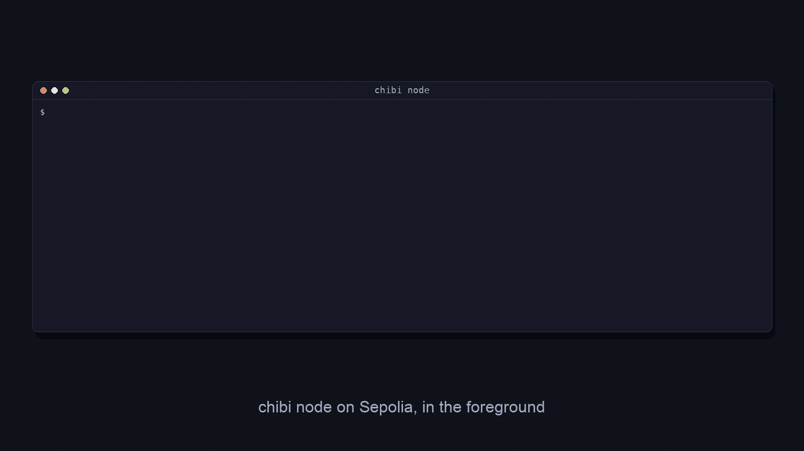
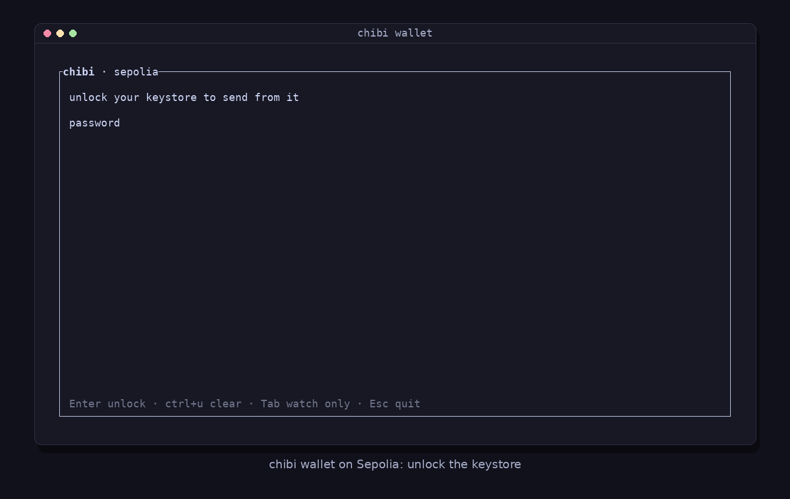

<h1 align="center">chibi</h1>

<p align="center"><b>A partial stateful Ethereum node.</b><br>
Sync the state you use in minutes. Transact through your own local RPC. Trust no provider.</p>

<p align="center">
  <a href="https://github.com/weiihann/chibi/releases/latest"></a>
  
  <a href="#license"></a>
</p>

<p align="center">
  <a href="assets/chibi-demo.mp4"></a>
  <br><sub><code>chibi node</code> serving MetaMask on Sepolia, waits sped up. Click to download the full-quality MP4.</sub>
</p>

```sh
curl -fsSL https://raw.githubusercontent.com/weiihann/chibi/main/install.sh | sh
chibi node
```

Point your wallet at `http://127.0.0.1:8545`, chain id `11155111`. That's it.

## Why chibi

A full node holds all of Ethereum's state and takes days to sync. An RPC provider answers at once, but you have to trust its answers. chibi holds only the accounts and storage your wallet uses, proves every value, and keeps it current block by block.

| | Full node | RPC provider | chibi |
|---|---|---|---|
| Ready to serve | days | instantly | **in minutes** |
| Data on disk | the whole chain | none | **kilobytes** |
| Checks the answers | yes, by re-executing | no | **yes, every value by proof** |

From a cold start, chibi served JSON-RPC after 20 s to 3 min in six Sepolia runs. Its data directory holds about 36 KB: the proven state itself stays in memory.

## What you get

- **A local RPC for any wallet.** Balances, `eth_call`, gas estimates, sends and receipts, served from proven state.
- **Every value proven.** Account and storage proofs from Ethereum peers, checked against headers a light client verified.
- **Current every block.** Block access lists (EIP-7928) update the state you hold without re-executing anything.
- **Direct sends.** Signed transactions go straight to Ethereum peers, and their receipts are proven too.
- **A terminal wallet.** `chibi wallet` sends ETH and tokens, resolves ENS names, watches balances read-only, and has cats.
- **Account history, if you want it.** Answer yes in `chibi init` and chibi keeps your accounts' sends, transfers, approvals and delegations, each checked against a verified block, and fills them in back to the Glamsterdam fork. `chibi status` and `h` in `chibi wallet` show them.

<p align="center">
  <a href="assets/chibi-wallet.mp4"></a>
  <br><sub><code>chibi wallet</code> sending 1 USDC on Sepolia, waits sped up. Click to download the full-quality MP4.</sub>
</p>

## Commands

| Command | |
|---|---|
| `chibi init` | Choose the network, the addresses to watch, whether to keep account history, and the RPC host and port (optional) |
| `chibi node` | Sync and serve JSON-RPC; `-b` runs it in the background |
| `chibi wallet` | The same node under a terminal wallet |
| `chibi status` | Whether chibi runs, the last proven balances, and recent account history when recorded |
| `chibi stop` | Stop a background chibi |

`chibi <command> --help` lists every option. The config lives in `~/.config/chibi/`, the data in `~/.local/share/chibi/<network>/`.

<details>
<summary>Other ways to install</summary>

The script installs a prebuilt binary for Linux (x86_64, arm64) or macOS (Intel, Apple silicon) into `~/.local/bin`. `CHIBI_INSTALL_DIR` picks another directory and `CHIBI_VERSION` (such as `v0.1.0`) a release.

From source, with [Rust](https://rustup.rs):

```sh
cargo install --locked --git https://github.com/weiihann/chibi chibi
```

</details>

## Trust model

- **Proven:** every account, balance, nonce, code, storage value and receipt is checked against a header whose hash the light client verified. A lying peer can stall chibi but cannot make it serve a wrong value.
- **Trusted:** the Ethereum sync committee, read through a beacon API (`beacon_url`, with a public default). On the first run a public checkpoint service picks the starting checkpoint unless you set `checkpoint`.
- **Seen by peers:** the peers that serve proofs see which accounts you query, and the network sees what you send. With account history on, peers also see which blocks chibi fetches receipts for, the blocks that may involve your accounts. Add your own node to `trusted_peers` with `trusted_only = true` to keep queries private.

## Status

Early software, Sepolia first. Mainnet support is in the code but untested, and `chibi wallet` does not send on mainnet.

## License

[MIT](LICENSE-MIT) or [Apache 2.0](LICENSE-APACHE), at your option.
